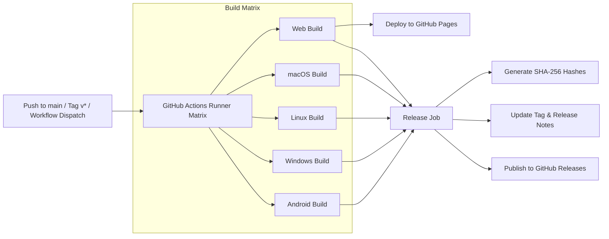

<div align="center">


# Libre Edu

**A modern, open-source educational streaming and offline learning app built with Flutter.**

[](https://github.com/chandranshB/libre_edu/actions/workflows/flutter-build.yml)
[](https://github.com/chandranshB/libre_edu/releases/latest)
[](https://chandranshb.github.io/libre_edu/)
[](https://flutter.dev)
[](https://dart.dev)
[](#-cross-platform-downloads)
[](LICENSE)

[**Live Web Demo**](https://chandranshb.github.io/libre_edu/) • [**Download Binaries**](#-cross-platform-downloads) • [**Features**](#-features) • [**CI/CD & Releases**](#-cicd-pipeline--automated-releases) • [**Development**](#-getting-started)

</div>

---

## 📖 Overview

**Libre Edu** is an open-source, cross-platform educational platform engineered to provide a seamless video streaming and offline learning experience. It combines high-performance HLS multi-bitrate video playback, background and floating miniplayer capabilities, local video downloads with FFmpeg processing, and an embedded PDF reader for course materials.

Whether studying on an Android mobile device, a desktop workstation (Windows, Linux, macOS), or directly through a web browser, Libre Edu delivers an intuitive, distraction-free environment.

---

## 📦 Cross-Platform Downloads

Every commit to `main` and all official releases automatically build and package binaries for all major platforms. You can always get the latest version from the links below:

| Platform | Download Link | File Type | Compatibility |
| :--- | :--- | :--- | :--- |
| 📱 **Android** | [**`libre_edu-android.apk`**](https://github.com/chandranshB/libre_edu/releases/latest/download/libre_edu-android.apk) | APK | Android 5.0+ (Phones & Tablets) |
| 🪟 **Windows** | [**`libre_edu-windows.zip`**](https://github.com/chandranshB/libre_edu/releases/latest/download/libre_edu-windows.zip) | Portable ZIP | Windows 10 / 11 (64-bit) |
| 🐧 **Linux** | [**`libre_edu-linux.zip`**](https://github.com/chandranshB/libre_edu/releases/latest/download/libre_edu-linux.zip) | Executable Bundle | Ubuntu / Debian / Fedora / Arch |
| 🍎 **macOS** | [**`libre_edu-macos.zip`**](https://github.com/chandranshB/libre_edu/releases/latest/download/libre_edu-macos.zip) | Application Archive | macOS 11+ (Intel & Apple Silicon) |
| 🌐 **Web** | [**`chandranshb.github.io/libre_edu`**](https://chandranshb.github.io/libre_edu/) *(or [Web ZIP](https://github.com/chandranshB/libre_edu/releases/latest/download/libre_edu-web.zip))* | Hosted App / ZIP | Any modern browser |
| 🔒 **Integrity** | [**`SHA256SUMS.txt`**](https://github.com/chandranshB/libre_edu/releases/latest/download/SHA256SUMS.txt) | Checksums | Verify package checksums |

> 💡 *To browse all previous releases and release notes, visit the [Releases page](https://github.com/chandranshB/libre_edu/releases).*

---

## ✨ Features

- 📺 **HLS Video Streaming (`.m3u8`)**
  - Smooth multi-quality adaptive streaming powered by [`media_kit`](https://pub.dev/packages/media_kit).
  - Manual video quality selector (1080p, 720p, 480p, 360p, 240p) with custom m3u8 playlist parsing.
  - Playback speed controls, seek intervals, volume, and fullscreen support.
- 🎛️ **Global Floating Miniplayer**
  - Continue watching or listening to lectures in a draggable floating miniplayer while exploring courses and reading documents.
  - Video progress tracking stored locally to resume playback right where you left off.
- ⬇️ **Offline Video Downloads**
  - In-app lecture download manager with real-time download progress.
  - HLS segment downloading and stitching with FFmpeg integration.
  - Dedicated Offline Downloads screen for offline study sessions without internet access.
- 📚 **Structured Course Hierarchy**
  - Deep hierarchical categorization: Batches → Subjects → Chapters → Video Lessons.
  - Detailed course overview including instructor details, brochures, and syllabus summaries.
- 📑 **In-App PDF Viewer**
  - Integrated PDF reading experience with [`syncfusion_flutter_pdfviewer`](https://pub.dev/packages/syncfusion_flutter_pdfviewer).
  - Zoom, pan, and page navigation for lecture notes, study slides, and course handouts.
- 🎨 **Adaptive Material 3 UI**
  - Deep-purple aesthetic with responsive grid and list layouts.
  - Automatic system theme switching between Light and Dark mode.

---

## ⚙️ CI/CD Pipeline & Automated Releases

Libre Edu features an automated GitHub Actions CI/CD workflow (`.github/workflows/flutter-build.yml`) that builds, verifies, packages, and publishes releases across all platforms.



### 1. Automated Rolling Releases (`latest`)
- **Trigger**: Every push or merge to the `main` or `master` branch.
- **Action**: All 5 platforms are compiled in parallel. Once all builds pass, the workflow downloads the artifacts, calculates SHA-256 hashes, force-updates the `latest` git tag, and publishes/refreshes the [Latest Release](https://github.com/chandranshB/libre_edu/releases/tag/latest).
- **Result**: You and your users can always download fresh binaries without waiting for manual release tagging!

### 2. Official Versioned Releases (`v*.*.*`)
- **Trigger**: Pushing a version tag like `v1.0.0` or `v0.2.0`.
- **Action**: Automatically generates a permanent GitHub Release with release notes generated from your commits, all platform assets attached, and marks it as the official release.

```bash
# Example: Creating an official release
git tag -a v1.0.0 -m "Release v1.0.0"
git push origin v1.0.0
```

### 3. On-Demand Releases (`workflow_dispatch`)
- Run releases manually at any time from the **GitHub Actions** tab:
  1. Go to **Actions** → **Flutter Build & Release All Platforms**.
  2. Click **Run workflow**.
  3. (Optional) Provide a specific release tag (e.g. `v1.0.1`) or leave empty to update the `latest` rolling release.
  4. (Optional) Check the pre-release box if publishing a beta or preview build.

### 4. Automated Web Deployment (GitHub Pages)
- When the `main` branch builds, the production Web build is automatically deployed to [GitHub Pages](https://chandranshb.github.io/libre_edu/).

---

## 🛠️ Architecture & Tech Stack

| Component | Technology | Description |
| :--- | :--- | :--- |
| **Framework** | [Flutter](https://flutter.dev) | Cross-platform UI toolkit |
| **Language** | [Dart](https://dart.dev) | Object-oriented client-optimized language |
| **State Management** | [`flutter_riverpod`](https://riverpod.dev) | Reactive caching and state management |
| **Routing** | [`go_router`](https://pub.dev/packages/go_router) | Declarative routing with nested shell navigation |
| **Media Playback** | [`media_kit`](https://pub.dev/packages/media_kit) | Hardware-accelerated cross-platform video player |
| **Document Viewer** | [`syncfusion_flutter_pdfviewer`](https://pub.dev/packages/syncfusion_flutter_pdfviewer) | PDF viewer widget |
| **Local Persistence**| [`shared_preferences`](https://pub.dev/packages/shared_preferences) | Stores playback progress and settings |
| **Offline Media** | [`ffmpeg_kit_extended_flutter`](https://pub.dev/packages/ffmpeg_kit_extended_flutter) | Media manipulation and stream stitching |

---

## 💻 Getting Started

### Prerequisites

Ensure you have installed:
- [Flutter SDK](https://docs.flutter.dev/get-started/install) (`>= 3.22.0`)
- [Dart SDK](https://dart.dev/get-dart)
- Platform toolchains for your target OS:
  - **Android**: Android Studio & Android SDK
  - **Windows**: Visual Studio 2022 with "Desktop development with C++"
  - **Linux**: `clang`, `cmake`, `ninja-build`, `pkg-config`, `libgtk-3-dev`, `libmpv-dev`, `liblzma-dev`
  - **macOS**: Xcode & Command Line Tools
  - **Web**: Google Chrome / modern browser

### Installation

1. **Clone the repository**:
   ```bash
   git clone https://github.com/chandranshB/libre_edu.git
   cd libre_edu
   ```

2. **Install Flutter dependencies**:
   ```bash
   flutter pub get
   ```

3. **Run the application**:
   ```bash
   # Run in Web browser
   flutter run -d chrome

   # Run on Windows
   flutter run -d windows

   # Run on Linux
   flutter run -d linux

   # Run on macOS
   flutter run -d macos

   # Run on connected Android device
   flutter run -d android
   ```

### Building for Release Locally

```bash
# Android APK
flutter build apk --release

# Windows Desktop
flutter build windows --release

# Linux Desktop
flutter build linux --release

# macOS Desktop
flutter build macos --release

# Web
flutter build web --release
```

---

## 🤝 Contributing

Contributions, feature requests, and suggestions are welcome!

1. Fork the Project.
2. Create your Feature Branch (`git checkout -b feature/amazing-feature`).
3. Commit your Changes (`git commit -m 'Add some amazing feature'`).
4. Push to the Branch (`git push origin feature/amazing-feature`).
5. Open a Pull Request.

---

## 📄 License

This project is open-source under the [MIT License](LICENSE).
